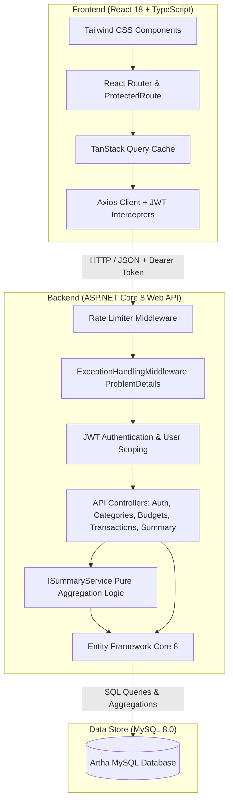
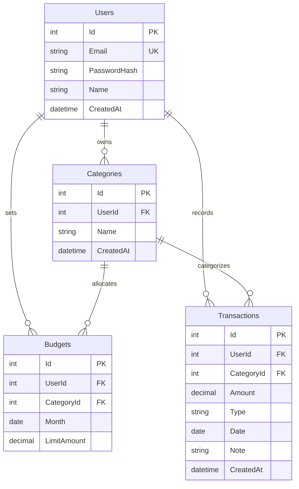
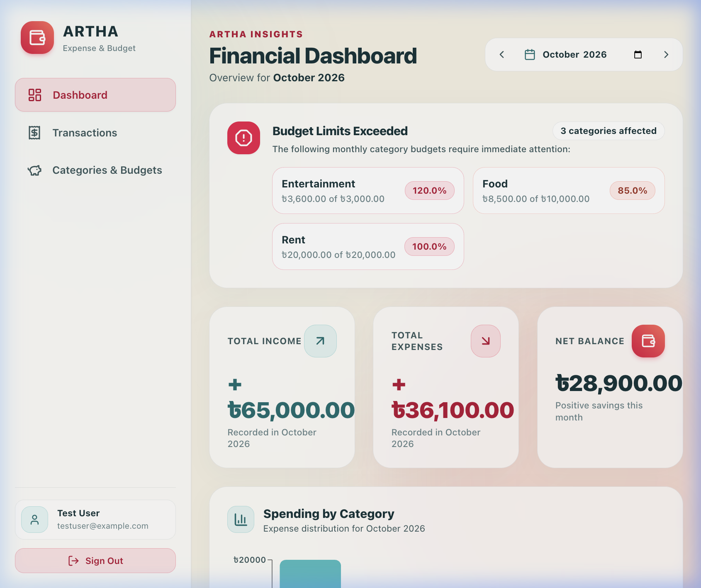
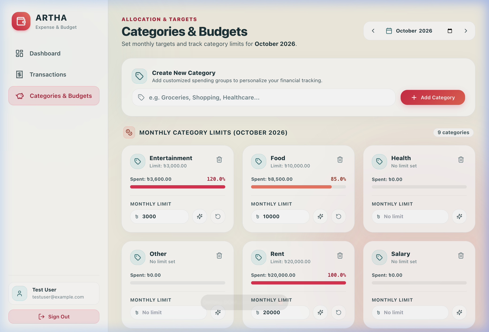
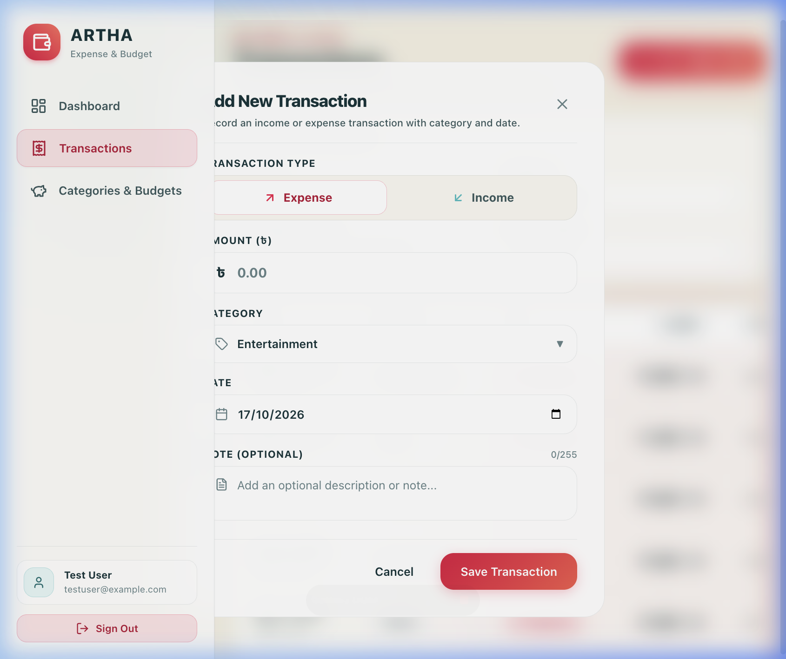
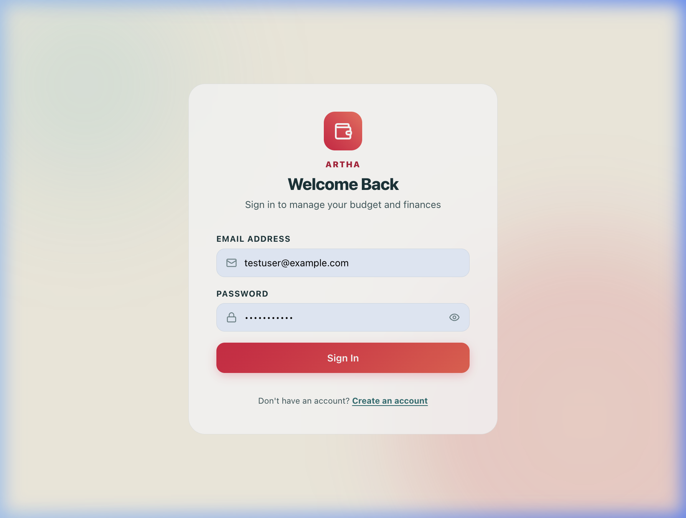
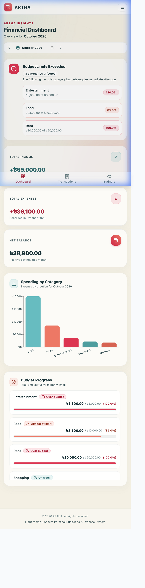
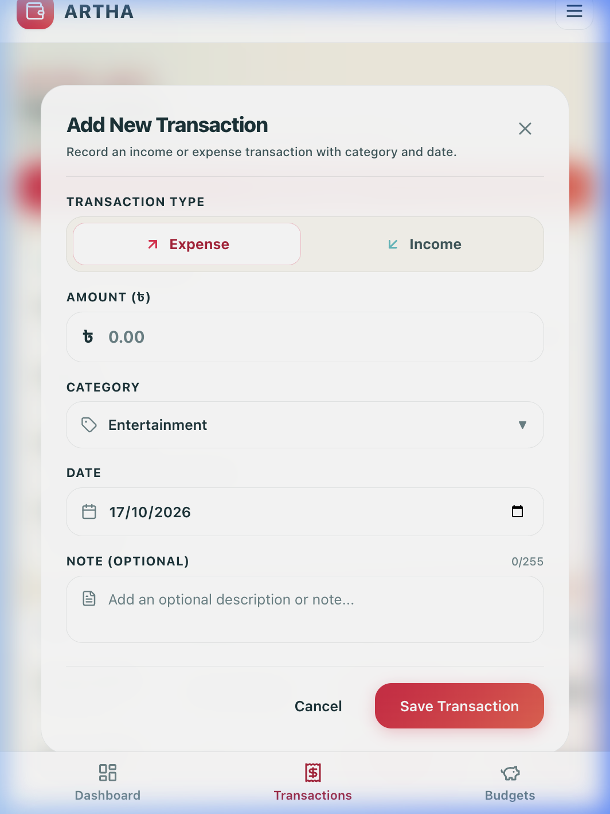
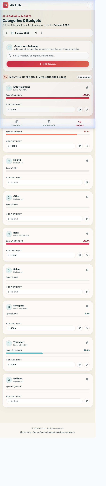

# ARTHA - Personal Expense & Budget Tracker

[](https://dotnet.microsoft.com/)
[](https://react.dev/)
[](https://www.typescriptlang.org/)
[](https://tailwindcss.com/)
[](https://www.mysql.com/)
[](https://www.docker.com/)

**ARTHA** is a secure, responsive, full-stack personal finance and budget management platform designed to help users track transactions, establish monthly category budgets, and analyze spending patterns with real-time budget threshold warnings.

> **Live Demo:** [https://artha-demo.placeholder.app](https://artha-demo.placeholder.app) *(Deployment Link Placeholder)*

---

## Table of Contents

- [Features](#features)
- [Tech Stack](#tech-stack)
- [Architecture & Design](#architecture--design)
- [Database Schema (ER Diagram)](#database-schema-er-diagram)
- [API Endpoints](#api-endpoints)
- [Getting Started Locally](#getting-started-locally)
  - [Prerequisites](#prerequisites)
  - [Option A: One-Command Docker Compose](#option-a-one-command-docker-compose-recommended)
  - [Option B: Local Development (CLI)](#option-b-local-development-cli)
- [Environment Variables](#environment-variables)
- [Running Tests & Linting](#running-tests--linting)
- [Screenshots](#screenshots)
- [Deployment](#deployment)
- [How I Built This with AI Tools (Antigravity)](#how-i-built-this-with-ai-tools-antigravity)

---

## Features

- **Authentication & Security**:
  - Secure signup & login using JWT (JSON Web Tokens) and BCrypt password hashing.
  - Rate limiting on `/auth/*` endpoints (15 req/min) to prevent brute-force attacks.
  - Strict user data isolation: all categories, budgets, and transactions are scoped to the authenticated user ID.
  - RFC 7807 `application/problem+json` consistent validation and error handling without stack trace leaks.
  - Automatic session expiry detection and notification banner.
- **Transactions Management**:
  - Full CRUD operations with modal-based creation and editing.
  - Multi-parameter filtering: month selector (`yyyy-MM`), category dropdown, and transaction type (`Income` vs `Expense`).
  - Server-side pagination with custom page sizes and newest-first sorting.
  - Inline confirmation for record deletion.
- **Monthly Budgets**:
  - Per-category monthly spending limits normalized to the first of the month.
  - Inline editable limits with immediate server updates and optimistic UI feedback.
  - Fast category management with duplicate prevention per user.
- **Dashboard & Analytics**:
  - Monthly financial overview cards (Total Income, Total Expenses, Net Savings/Balance).
  - Spending breakdown visualization using Recharts.
  - Three-tier category budget progress tracking:
    - **Normal** (< 80%): Green progress indicator.
    - **Warning** (80% - 99%): Amber progress indicator.
    - **Exceeded** (>= 100%): Red progress indicator.
  - Prominent warning banners summarizing all categories exceeding safe budget thresholds.
- **Responsive Modern UI**:
  - Dark-mode aesthetics with vibrant indigo/emerald accents, subtle micro-animations, and responsive layouts across desktop and mobile.

---

## Tech Stack

| Layer | Technology | Description |
| :--- | :--- | :--- |
| **Frontend Framework** | React 18 + Vite | High-performance SPA tooling and component architecture |
| **Language** | TypeScript | Strict end-to-end type safety matching backend DTOs |
| **Styling** | Tailwind CSS | Modern utility-first responsive styling and curated color palette |
| **Data Fetching & Cache** | TanStack Query v5 | Efficient server-state management, cache invalidation, and optimistic updates |
| **Routing** | React Router v6 | Client-side routing with protected authenticated routes |
| **Charts & Icons** | Recharts & Lucide React | Clean financial data visualizations and modern iconography |
| **Backend Framework** | ASP.NET Core 8 Web API | High-performance RESTful API with C# 12 |
| **ORM & Database** | Entity Framework Core 8 + Pomelo MySQL | Relational data access, migrations, and database-level aggregations |
| **Security & Auth** | JWT Bearer & BCrypt.Net | Token-based authentication and secure password hashing |
| **Rate Limiting** | ASP.NET Core RateLimiter | Built-in fixed-window rate limiting middleware |
| **API Documentation** | Swagger / OpenAPI | Interactive API documentation with JWT Bearer authorization |
| **Database Engine** | MySQL 8.0 | ACID-compliant relational data storage with foreign key constraints |
| **Testing** | xUnit & Moq / EF InMemory | Pure unit tests for budget status logic and service queries |
| **Containerization** | Docker & Docker Compose | Multi-stage production container and local service orchestration |

---

## Architecture & Design



---

## Database Schema (ER Diagram)

The database schema is intentionally normalized into 4 core tables with referential integrity:



---

## API Endpoints

All endpoints except `/auth/*` require an `Authorization: Bearer <token>` header.

| Method | Endpoint | Description | Auth Required | Status Codes |
| :--- | :--- | :--- | :---: | :--- |
| `POST` | `/auth/register` | Register new user account | No | `200`, `400`, `409` |
| `POST` | `/auth/login` | Authenticate user and receive JWT | No | `200`, `400`, `401`, `429` |
| `GET` | `/categories` | List authenticated user's categories | Yes | `200`, `401` |
| `POST` | `/categories` | Create new category (unique per user) | Yes | `201`, `400`, `401`, `409` |
| `DELETE` | `/categories/{id}` | Delete category (fails if transactions exist) | Yes | `204`, `401`, `404`, `409` |
| `GET` | `/transactions` | List transactions (supports `month`, `categoryId`, `type`, `page`, `pageSize`) | Yes | `200`, `400`, `401` |
| `GET` | `/transactions/{id}` | Retrieve single transaction | Yes | `200`, `401`, `404` |
| `POST` | `/transactions` | Create new transaction | Yes | `201`, `400`, `401` |
| `PUT` | `/transactions/{id}` | Update existing transaction | Yes | `200`, `400`, `401`, `404` |
| `DELETE` | `/transactions/{id}` | Delete transaction | Yes | `204`, `401`, `404` |
| `GET` | `/budgets?month=yyyy-MM` | Get category budgets for specific month | Yes | `200`, `400`, `401` |
| `PUT` | `/budgets` | Upsert budget (setting limit to 0 or null removes it) | Yes | `200`, `400`, `401` |
| `GET` | `/summary?month=yyyy-MM` | Aggregated monthly totals, savings, and category budget statuses | Yes | `200`, `400`, `401` |

---

## Getting Started Locally

### Prerequisites
- [Git](https://git-scm.com/)
- [.NET 8 SDK](https://dotnet.microsoft.com/download/dotnet/8.0)
- [Node.js 18+](https://nodejs.org/) & `npm`
- [Docker](https://www.docker.com/) (optional, for containerized run)

### Option A: One-Command Docker Compose (Recommended)
Clone the repository and run Docker Compose to bring up both MySQL and the ASP.NET Core API:

```bash
git clone https://github.com/placeholder/artha.git
cd Artha

# Start MySQL database and API backend
docker compose up --build -d

# Start Frontend dev server
cd frontend
npm install
npm run dev
```

- Frontend: `http://localhost:5173`
- Backend API & Swagger: `http://localhost:5050/swagger`

---

### Option B: Local Development (CLI)

#### 1. Start MySQL Container
```bash
docker compose up -d db
```

#### 2. Configure Backend User Secrets & Run API
```bash
cd backend/src/FinanceTracker.Api

# Set your local JWT signing key (minimum 32 characters)
dotnet user-secrets set "Jwt:Key" "super_secret_local_dev_jwt_key_that_is_long_enough_for_sha256"

# Run the API
dotnet run --urls "http://localhost:5050"
```
*Note: In non-production, EF Core migrations are applied automatically upon API startup.*

#### 3. Start Frontend Client
In a new terminal:
```bash
cd frontend
npm install
npm run dev
```

Open `http://localhost:5173` in your browser.

#### 4. Seed Demo Data (Optional)
To instantly visualize warning and exceeded budget thresholds, execute the seed script against MySQL:
```bash
docker exec -i artha-db mysql -u financetracker -pfinancetracker_secret financetracker < scripts/seed-demo.sql
```
Credentials for the seeded demo account:
- **Email:** `testuser@example.com`
- **Password:** `Password123`

---

## Environment Variables

### Backend Configuration (`appsettings.json` or Environment Variables)

| Variable | Default (Dev) | Description |
| :--- | :--- | :--- |
| `ASPNETCORE_ENVIRONMENT` | `Development` | Setting to `Production` masks error call stacks |
| `ConnectionStrings__DefaultConnection` | `Server=localhost;Port=3306;Database=financetracker;...` | MySQL connection string |
| `Jwt__Key` | *(Stored in user-secrets)* | 256-bit secret key (min 32 characters) |
| `Jwt__Issuer` | `FinanceTrackerApi` | JWT Issuer claim |
| `Jwt__Audience` | `FinanceTrackerClient` | JWT Audience claim |
| `FrontendOrigin` | `http://localhost:5173` | Allowed origin for CORS policy |

### Frontend Configuration (`frontend/.env`)

| Variable | Default | Description |
| :--- | :--- | :--- |
| `VITE_API_URL` | `http://localhost:5050` | Base URL of the backend API |

---

## Running Tests & Linting

### Backend Tests
Execute unit tests covering budget calculation thresholds, pure static methods, and summary queries:
```bash
dotnet test backend/FinanceTracker.sln
```

### Frontend Typecheck & Linting
Run Oxlint and TypeScript compiler:
```bash
cd frontend
npm run lint
npm run build
```

---

## Screenshots

### Desktop View (Light Theme)
| Financial Dashboard & Warnings | Categories & Budgets Card Grid |
| :---: | :---: |
|  |  |

| Transaction Management & Modal | Secure Light Authentication |
| :---: | :---: |
|  |  |

### Responsive Mobile View (375px)
| Mobile Dashboard | Mobile Transactions Modal | Mobile Budgets Grid |
| :---: | :---: | :---: |
|  |  |  |

---

## Deployment

Refer to [`DEPLOYMENT.md`](DEPLOYMENT.md) for a comprehensive guide on hosting:
- **Frontend**: Deployed to [Vercel](https://vercel.com) with Single Page Application rewrites.
- **Backend API**: Deployed to [Render](https://render.com) or [Railway](https://railway.app) using the multi-stage `backend/Dockerfile`.
- **Database**: Managed MySQL on [Aiven](https://aiven.io) or [Railway](https://railway.app).

---

## How I Built This with AI Tools (Antigravity)

This project was built following a structured, spec-driven engineering methodology pairing human architectural review with Google Antigravity:

1. **Spec-First Engineering**: Before writing code, a comprehensive requirements specification was drafted defining exact data schemas (4 tables), strict user data isolation, decimal precision constraints, and API contracts.
2. **Step-by-Step Prompt Execution**:
   - *Phase 1*: Domain models, EF Core migrations, and JWT authentication with BCrypt.
   - *Phase 2*: Scoped CRUD operations for Categories and Transactions with ownership verification.
   - *Phase 3*: Database-grouped budget aggregation logic and pure unit tests for 80% and 100% threshold calculations.
   - *Phase 4*: Frontend scaffolding in Vite + React 18, TanStack Query caching, and responsive UI components.
   - *Phase 5*: Hardening, RFC 7807 problem details, rate limiting, and zero-warning build passes.
3. **Rigorous Review & Automated Verification**:
   - Every single backend modification was verified via `dotnet test` and live cURL requests testing edge cases (e.g., verifying that referencing another user's category returns HTTP 400).
   - Automated headless browser subagents validated end-to-end user flows, toast notifications, and responsive layouts.
